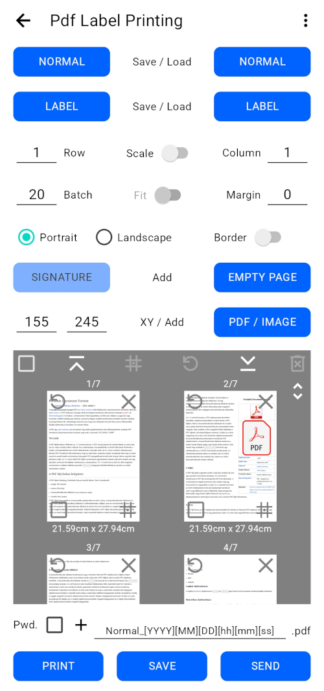
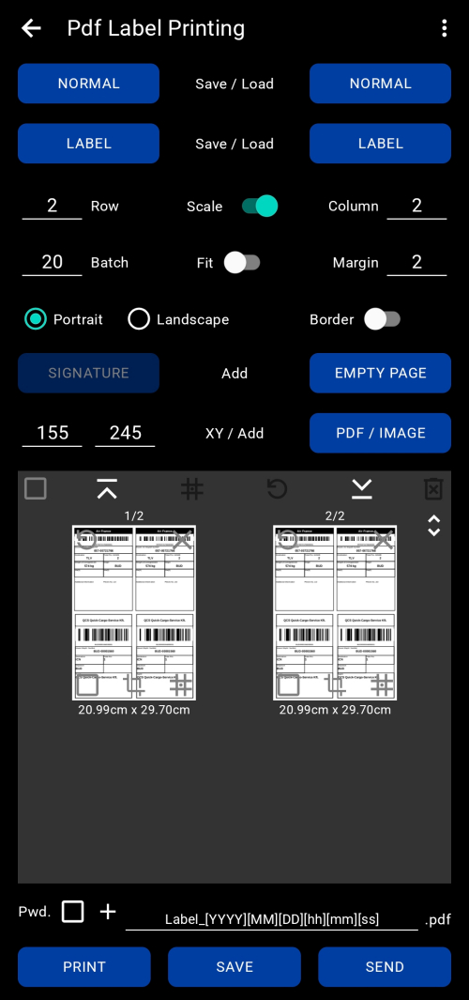
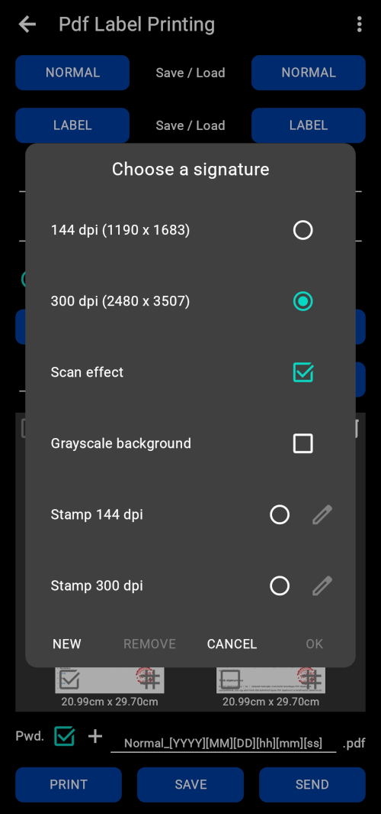

# PdfLabelPrinting (PDF Label Printing app)

Android application for PDF-based label printing.  
It turns existing PDF documents and images (e.g. AWB label, CMR, consignment note, delivery note, invoice, order)
into printable pages on a touch screen: it places several pages or cropped labels on one A4 sheet,
signs or stamps them, and prints, saves or sends the result.

Everything runs locally on the device; the app has no internet access and collects no data.

We publish the source code so that others can use it, modify it and learn from it.


## Features

### Opening documents

- Open PDF files from the built-in file picker, the Android “Share” menu or “Open with”
- Share several PDFs at once; every new file is appended to the current page list
- Import JPG and PNG images (up to 8411 x 8411 px); each image becomes a page of its own size
- Open password-protected PDFs (the app asks for the password and asks again if it is wrong)
- Form fields and printable annotations are kept visible on the pages, hidden layers stay hidden
- Damaged PDFs are repaired automatically (MuPDF); if that fails, the app tries an earlier saved revision
  of the file
- Faulty page boxes, page contents and font encodings are repaired during import

### Page layout

- Place several pages or labels on one A4 sheet: **Row** × **Column** grid (1–100 each),
  in portrait or landscape orientation
- **Margin** in millimetres around and between the cells (0–100 mm)
- **Scale**: every page or label is scaled to fill its cell, so small labels are enlarged
  for better print quality; when it is off, pages are only reduced, never enlarged
- **Fit** (together with Scale): measures the real content of the page (MuPDF), trims the empty border
  and fills the cell with the content only
- **Border**: draws a frame around every cell
- **Position on page**: aligns the page inside its cell to one of 9 positions (corners, edges, centre),
  for all pages or for the selected ones
- **Free crop**: cut out any area of a page with a live preview, for one page group or for all pages,
  and reset it at any time
- Rotate pages 90° to the left, one by one or all selected ones together
- Add an empty page to the end of the list, with the exact size of the first page
- The layout is rebuilt automatically whenever a setting changes
- Repeated processing (editing, changing the layout, opening a saved result again) does not keep adding new
  nesting levels to the page content: wrapper levels are merged when the layout is built, so the pages of large,
  repeatedly processed files stay fast and use little memory

### Page list

- Thumbnail grid of the output pages with page number and page size, fast scrolling and
  jump-to-start / jump-to-end buttons, even for documents with thousands of pages
- Reorder pages by drag and drop
- Select one, several or all pages; delete, rotate or position the selection in one step
- Every thumbnail has its own delete, rotate, position and crop buttons
- Tap a thumbnail to open the result in the built-in PDF viewer or in an external app

### Signature, stamp, watermark

- Add a PNG signature, stamp, logo or watermark to the selected pages
- Keep your own library of signature images (add new ones, remove old ones)
- Set the position in millimetres (X / Y); with a single page selected, tap the pencil icon
  to drag the signature to its place on the page preview
- Choose the resolution: 144 dpi or 300 dpi
- Optional **scan effect** and **grayscale background**
- The signed page is rasterized: the page content and the image become a single picture,
  so the signature cannot be removed from the PDF later
- This saves you the usual routine of printing the document, signing it by hand, scanning it back and then
  sending the scanned copy, for example by e-mail: with the app you sign or stamp the document and send it
  right away

### Built-in PDF viewer and editor

- Built-in PDF viewer based on the AndroidX PDF component (Android 9+); it can be turned off in the menu,
  then an external app opens the result
- Search and text selection (Android 12+ with S Extension 13+)
- Edit pages: draw and highlight with the AndroidX PDF editing tools (Android 12+ with S Extension 18+)
- Saved edits stay on the pages even when the layout settings change later
- Remove saved edits from the visible pages or from all pages
- Edits stored in a file that was saved earlier and opened again become part of the page and
  cannot be removed separately

### Output

- **Print** with the Android print service
- **Save** to any location with the system file dialog
- **Send** to any app that accepts PDF files
- Optional password protection of the output (AES-256); the password has to be typed twice
- File name template with date and time tokens: `[YYYY]`, `[YY]`, `[MM]`, `[DD]`, `[hh]`, `[mm]`, `[ss]`;
  characters that are not allowed in file names are replaced

### Settings

- Two setting profiles, **NORMAL** and **LABEL** (grid, margin, orientation, border, scale, fit, position,
  crop, batch size, signature position, password protection, file name template), saved and loaded with
  one tap
- Export the settings to an XML file and import them again, for example on another device
- **Batch**: number of pages processed in one step, from 1 (stable, low memory) to 100 (fast)
- Light, dark or phone theme
- English and Hungarian user interface
- “About the app” window with the version number and links to this page, the privacy policy,
  the licenses, the source code and the contact address

### Long operations

- Progress window with percentage and a cancel button; cancelling restores the previous state
- Processing continues in the background with a notification, and the screen stays on while the app is open
- “Battery optimization” help in the menu, because some phones stop background work during long operations
- Built for very large documents: pages are processed in batches to keep memory usage low
- Requires Android 7.0 or newer (API 24+)


## Screenshots

<p style="text-align: center;">
  
</p>

<p style="text-align: center;">
  
</p>

<p style="text-align: center;">
  
</p>


## Legal notice

The “signatures” created with this app **are not qualified electronic signatures and must not be
considered any kind of official, legally regulated signature**. The app is intended primarily for
personal / demonstration use, and you use it at your own risk.

The developer of the application **accepts no liability** for any legal consequences
or damages arising from the use of documents created in this way.


## Privacy

The app does not collect, store or transmit any personal data to a server. Details: `PRIVACY_POLICY.md`.


## Build / development

- Minimum SDK: 24
- Target / Compile SDK: 37
- Android Gradle Plugin: 9.4.x
- Java / Kotlin toolchain: 21

Typical build commands:

```bash
./gradlew assembleDebug
./gradlew assembleRelease
```

In Android Studio, simply open the project directory.

Some unit tests use real-world PDF files: regression tests for earlier fixes look up specific files by name,
and the form and annotation import test uses every PDF in a `Forms_and_annotations` folder.
Put them into the `work/00_test_PDFs` folder, in any subfolders; `work/00_test_PDFs/README.md` lists the needed
files and where to get them. Without them these tests are skipped. The tests write their results into
`work/00_test_PDFs_work`. Both folders are described in their own README, and the files placed in them are never
committed.


## License

The entire project (unless otherwise noted) is available under the terms of the

> **GNU Affero General Public License 3.0 or later**  
> (`AGPL-3.0-or-later`)

- A summary of the license is contained in the `LICENSE` and `NOTICE` files.
- The most important external dependencies and their licenses: `THIRD_PARTY_LICENSES.md`.

**Important:** the application uses the following libraries, which are themselves
available under AGPL-3.0 or a commercial license:

- **iText Core for Android (9.x)** – PDF processing and generation, password protection
- **MuPDF (Android/Java bindings)** – content bounds measurement, repair of damaged PDFs
  and password checking

If the AGPL terms are not suitable for the given project,
then you will need your own commercial licenses (iText: Apryse, MuPDF: Artifex).


## Open source

If you distribute the application or a modified version of it (for example in the Google Play Store),
the AGPL license requires you to make the complete, modified source code
publicly available as well (under an AGPL-compatible license).

The source code of this app: https://github.com/reelee81/PdfLabelPrinting  
The app shows this link in the “About the app” window.


## Acknowledgements / Inspiration

The built-in PDF viewer is based on the AndroidX PDF component. Thanks to the AndroidX PDF Viewer team:  
https://developer.android.com/jetpack/androidx/releases/pdf

The development of the application was inspired and bootstrapped by:

- [PDF N-Up Tool](https://github.com/Mollayo/PDF_N-Up_Tool) – An Android app to print multiple PDF pages per sheet.


## Contact

If you find a bug or would like to suggest a change, it is recommended to open a GitHub issue,
or fork the repository and send a Pull Request.

E-mail: reelee81@gmail.com
